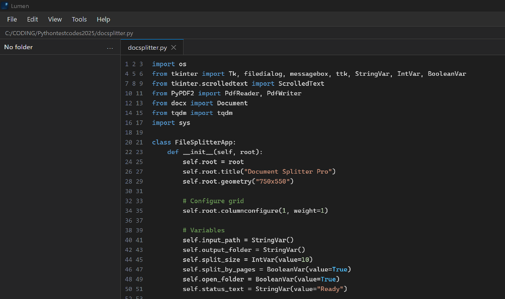
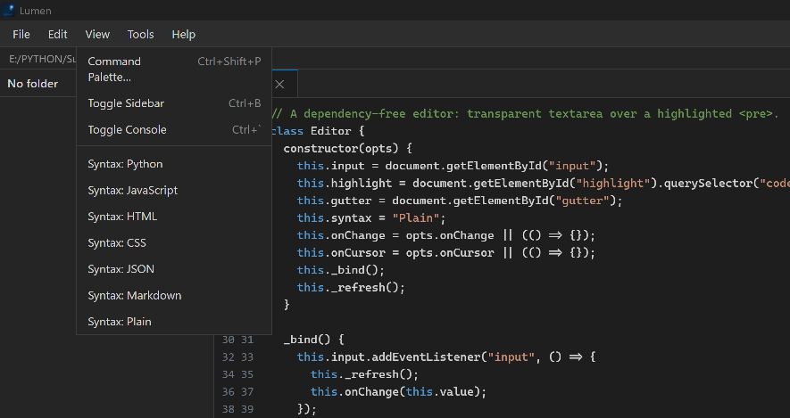

# ⚡ Lumen

### A lightweight, cross-platform alternative to Sublime Text

If you find this software useful, you can support its development:

<!--START_SECTION:buy-me-a-coffee-->

<!--END_SECTION:buy-me-a-coffee-->

 

 
 

 
[Features](#-features) • [Installation](#-installation) • [Usage](#-usage) • [Plugins](#-plugin-support) • [Building an .exe](#-building-a-standalone-exe) • [Shortcuts](#-keyboard-shortcuts)

## Why Lumen?

...

## Features

### Editor
- ✨ Syntax highlighting (Python, JS, HTML, CSS, JSON, Markdown)
- 🖱️ Native file dialogs
- 📑 Tabs
- 🔍 Find / Replace / Replace All
- 🎯 Go to line
- ⌨️ Full keyboard shortcuts
- 📝 Paste with auto-indent
- 🧠 Auto-indent on Enter
- 🎁 Auto-close brackets/quotes
- 📋 Duplicate, delete, move lines
- 💬 Smart comment toggle per language

### Plugins
- 🔌 Install Sublime Text plugins (.py)
- 📦 Sublime `sublime` and `sublime_plugin` API shim
- 🎛️ Plugin commands appear in Command Palette

### Build
- 🏃 Run Python, Node, Make
- 📊 Output console

### Windows
- 🪟 Native desktop window (pywebview)
- 🖼️ Custom icon
- 📌 File associations (.txt .php .html .py)
- 🚀 Standalone .exe via PyInstaller

## Installation
...

## Usage
...

## Plugin Support
...

## Building a Standalone .exe
...

## Keyboard Shortcuts
[table]

## Contributing
...

## License
MIT
