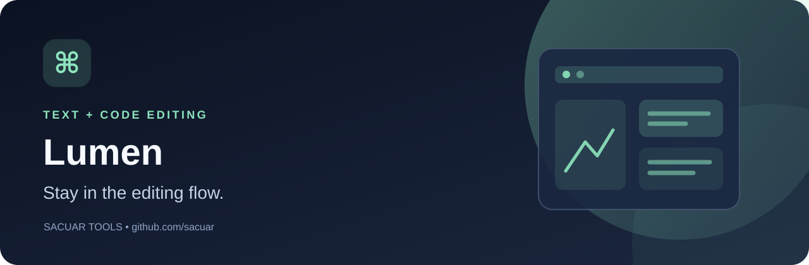

<div align="center">



# Lumen

**A lightweight keyboard-first editor for text and code, built for focused local work.**

[](https://github.com/sacuar/Lumen#install--try) [](https://github.com/sacuar/Lumen/releases/latest) [](https://github.com/sacuar/Lumen/issues)

**[DOWNLOAD / RELEASES](https://github.com/sacuar/Lumen/releases)** · **[VIEW SOURCE](https://github.com/sacuar/Lumen)** · [More SACUAR apps](https://github.com/sacuar)

</div>

<div align="center">

[](https://github.com/sacuar/Lumen/stargazers) [](https://github.com/sacuar/Lumen/releases/tag/v1.2.0)

[View visitors and referral sources](https://github.com/sacuar/Lumen/graphs/traffic) · [All releases](https://github.com/sacuar/Lumen/releases)

</div>

## Why use Lumen?

- Edit multiple files with tabs, search, replace, syntax highlighting and a command palette.
- Browse project folders and use built-in shortcuts for everyday editing.
- Run a Python-backed local editor in the browser or through a Windows desktop launcher.

## Install / try

Open **[GitHub Releases](https://github.com/sacuar/Lumen/releases)**, choose the latest suitable Windows asset, review its release notes and known limitations, and follow the installer instructions. If no verified installer is available, use the documented source-build instructions below. Download only from the official project release page.

**Early development:** Lumen is not a complete Sublime Text replacement. Its Windows runtime, plugin compatibility and installer require further testing.

**Licence:** [Clarification is pending](LICENSING.md). The existing LICENSE file is empty; no open-source licence is granted by this README.

## Screenshots and first look

Real interface captures are available in the [Screenshots section](#screenshots) below. The banner above is branding artwork, not a product screenshot.

## Get involved

[Roadmap](ROADMAP.md) · [Contribute](CONTRIBUTING.md) · [Report issues](https://github.com/sacuar/Lumen/issues/new). Please report your Windows version, application version and steps to reproduce. Screenshots of reproducible issues help.

---

## Detailed documentation

## What is Lumen?

Lumen is an **independent code editor project** for people who want a responsive, keyboard-friendly, customisable editing experience. It aims to offer useful Sublime Text-style workflows in a small application, without pretending to be a full drop-in replacement.

The current project uses a Python HTTP service bound to localhost and a browser-based editing interface; a separate `pywebview` launcher provides a native desktop window. **Windows is the primary packaged target.** Other platforms and compatibility require additional testing.

Lumen is **not affiliated with or endorsed by Sublime HQ**.

## Current functionality

| Area | Implemented in the repository | Important limitation |
|---|---|---|
| Editing | Tabs, file open/save, find and replace, go to line, common shortcuts | Needs broader usability and regression testing |
| Syntax | Python, JavaScript, HTML, CSS, JSON and Markdown highlighting | Lightweight regex-based highlighting, not a language server |
| Navigation | Folder sidebar and command palette | Project indexing/search improvements welcome |
| Tools | Python, Node and Make build commands with an output console | Commands depend on local runtimes; running code executes commands on your computer |
| Plugins | Experimental `sublime`/`sublime_plugin` Python shim and plugin loader | **Partial compatibility only**; many Sublime packages will not work |
| Desktop | `pywebview` launcher, custom icon and Windows packaging scripts | Packaging and platform support need testing |

This table describes functionality found in source, not a guarantee that every feature is bug-free.

## Getting started

### 1. Try the source in your browser

Install Python 3 and clone the repository:

```bash
git clone https://github.com/sacuar/Lumen.git
cd Lumen
python -m lumen
```

Lumen starts a local HTTP server and attempts to open **http://127.0.0.1:8765** in your browser. The backend uses the Python standard library; some native dialogs depend on Tkinter being installed.

### 2. Native desktop window

Install the desktop dependency:

```bash
python -m pip install pywebview
python lumen_win.py
```

The native window launcher and Windows build are most relevant to Windows users. Platform-specific dependencies for `pywebview` vary.

### 3. Existing Windows executable

An older Windows executable is available in the [Lumen release](https://github.com/sacuar/Lumen/releases/tag/smart_text_editor) (`Lumen_V1.1.exe`). **It is an existing release, not a newly tested build.** Please report startup or packaging problems.

To package from source on Windows, review `build_windows.bat` and `Lumen.spec`. The build script installs `pywebview` and `PyInstaller`, then builds `dist/Lumen/Lumen.exe`.

## Windows 1.2.0 edition

The Windows installer bundles the Python runtime and editor dependencies. WebView2 Runtime is required (normally already installed on Windows 11). No separate Python installation is required for editing or previews.

- Explorer: **Open with Lumen**, **Open folder in Lumen**.
- Windows Settings → Apps → Default apps → Lumen: select .txt and other text extensions yourself. The installer does not replace Notepad.exe or bypass Windows user choice.
- Read-only PDF, raster image and DOCX previews.
- Settings → Python interpreter: Auto (3.12 first, then 3.14), 3.12, or 3.14 for executing Python scripts. Script execution requires that interpreter locally.
- Source: run `run_windows.bat auto` or `run_windows.bat 3.14`.
- Installer build: run `build_windows.bat auto`, `build_windows.bat 3.12`, or `build_windows.bat 3.14` (requires Inno Setup 6). Separate virtual environments avoid mixing Python versions.
- The CI release uses Python 3.12, with a separate 3.14 compatibility test. Build and installation status are shown in Actions.
- Release checks notify you of a newer version and open its official release page; no unattended installation.

Existing screenshots below/above show the earlier editor interface. Windows runtime validation remains necessary.

## Keyboard shortcuts

| Action | Shortcut |
|---|---|
| Open file | `Ctrl+O` |
| Save | `Ctrl+S` |
| Find / Replace | `Ctrl+F` / `Ctrl+H` |
| Go to line | `Ctrl+G` |
| Command palette | `Ctrl+Shift+P` |
| Build current file | `Ctrl+B` |
| Toggle comment | `Ctrl+/` |
| Duplicate line | `Ctrl+Shift+D` |

Shortcut definitions and menu bindings are in [`lumen/keymaps.py`](lumen/keymaps.py) and [`lumen/menus.py`](lumen/menus.py). Some actions need verification across platforms.

## Plugin support

Lumen includes an **experimental** Sublime-style Python compatibility layer in [`sublime_shim/`](sublime_shim/) and a loader in [`lumen/plugin_loader.py`](lumen/plugin_loader.py).

It is **not** the complete Sublime Text API or an assurance that existing packages will work. Please report compatibility gaps with a minimal sample plugin and expected/actual behaviour.

**Security:** Python plugins and build commands can execute code with your user account's permissions. Only load plugins and run build configurations you trust.

## Contributing

**We are actively looking for contributors.** You can help with editing behaviour, Windows packaging, accessibility, syntax support, plugin compatibility, UI responsiveness, testing and documentation.

A good starting point is the [development roadmap](ROADMAP.md), the [open issues](https://github.com/sacuar/Lumen/issues), or the [contribution guide](CONTRIBUTING.md). Bug reports, design feedback and documentation improvements are valuable even without a code contribution.

1. Open an issue or comment on an existing one to discuss the change.
2. Fork the repository and make a focused branch.
3. Test the affected feature and explain what changed in your pull request.
4. Follow the [contribution guide](CONTRIBUTING.md) and [pull request template](.github/PULL_REQUEST_TEMPLATE.md).

**Licensing note:** The repository's `LICENSE` file is currently empty, and earlier README files made conflicting licence claims. **No licence has been selected or granted through this README.** Before submitting code, review the [licensing status](LICENSING.md) and request clarification from the maintainer. Do not assume the project is MIT-licensed or use the source beyond applicable rights without permission.

## Project structure

| Path | Purpose |
|---|---|
| [`lumen/`](lumen/) | Python server, syntax rules, build tools and plugin management |
| [`ui/`](ui/) | Browser-based editor, menus, search, sidebar and styles |
| [`sublime_shim/`](sublime_shim/) | Partial compatibility API for Sublime-style Python plugins |
| [`lumen_win.py`](lumen_win.py) | Native desktop launcher |
| [`build_windows.bat`](build_windows.bat) | Windows packaging script |
| [`docs/screenshots/`](docs/screenshots/) | Interface screenshots |

## About and support

Created and maintained by **[sacuar](https://github.com/sacuar)**. Lumen is a personal software project looking for users, testers, designers and developers willing to help shape it.

[☕ Support ongoing development](https://buymeacoffee.com/sacuar) · [Suggest an improvement](https://github.com/sacuar/Lumen/issues/new/choose) · [See the roadmap](ROADMAP.md)

*Please give credit to the creator when sharing the project. Attribution is appreciated; legal permissions depend on the licence eventually selected and any permissions already granted.*
