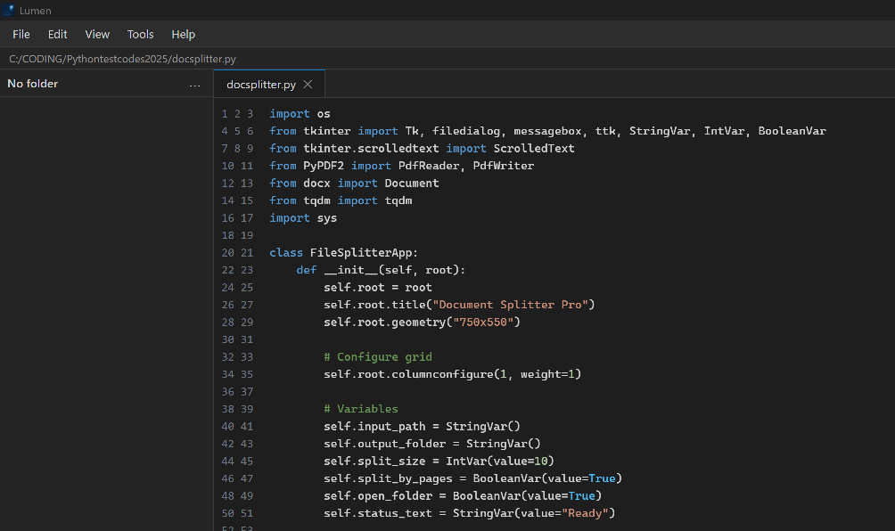
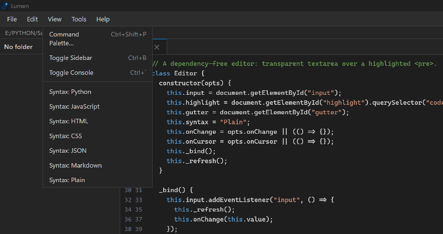

<div align="center">

# ⚡ Lumen

**A lightweight text and code editor inspired by the speed and workflow of Sublime Text.**

Early-stage desktop editor • Python backend • HTML/CSS/JavaScript interface

**Contributors welcome — help make Lumen faster, more reliable and easier to extend.**

[](CONTRIBUTING.md)
[](ROADMAP.md)
[](https://github.com/sacuar/Lumen/issues)

[**Get started**](#getting-started) · [**Contribute**](#contributing) · [**Roadmap**](ROADMAP.md) · [**Report a bug**](https://github.com/sacuar/Lumen/issues/new/choose) · [**Windows release**](https://github.com/sacuar/Lumen/releases/tag/smart_text_editor)

</div>

## Screenshots





*Screenshots from the repository. The interface may change during development.*

## What is Lumen?

Lumen is an **independent code editor project** for people who want a responsive, keyboard-friendly, customisable editing experience. It aims to offer useful Sublime Text-style workflows in a small application, without pretending to be a full drop-in replacement.

The current project uses a Python HTTP service bound to localhost and a browser-based editing interface; a separate `pywebview` launcher provides a native desktop window. **Windows is the primary packaged target.** Other platforms and compatibility require additional testing.

Lumen is **not affiliated with or endorsed by Sublime HQ**.

## Current functionality

| Area | Implemented in the repository | Important limitation |
|---|---|---|
| Editing | Tabs, file open/save, find and replace, go to line, common shortcuts | Needs broader usability and regression testing |
| Syntax | Python, JavaScript, HTML, CSS, JSON and Markdown highlighting | Lightweight regex-based highlighting, not a language server |
| Navigation | Folder sidebar and command palette | Project indexing/search improvements welcome |
| Tools | Python, Node and Make build commands with an output console | Commands depend on local runtimes; running code executes commands on your computer |
| Plugins | Experimental `sublime`/`sublime_plugin` Python shim and plugin loader | **Partial compatibility only**; many Sublime packages will not work |
| Desktop | `pywebview` launcher, custom icon and Windows packaging scripts | Packaging and platform support need testing |

This table describes functionality found in source, not a guarantee that every feature is bug-free.

## Getting started

### 1. Try the source in your browser

Install Python 3 and clone the repository:

```bash
git clone https://github.com/sacuar/Lumen.git
cd Lumen
python -m lumen
```

Lumen starts a local HTTP server and attempts to open **http://127.0.0.1:8765** in your browser. The backend uses the Python standard library; some native dialogs depend on Tkinter being installed.

### 2. Native desktop window

Install the desktop dependency:

```bash
python -m pip install pywebview
python lumen_win.py
```

The native window launcher and Windows build are most relevant to Windows users. Platform-specific dependencies for `pywebview` vary.

### 3. Existing Windows executable

An older Windows executable is available in the [Lumen release](https://github.com/sacuar/Lumen/releases/tag/smart_text_editor) (`Lumen_V1.1.exe`). **It is an existing release, not a newly tested build.** Please report startup or packaging problems.

To package from source on Windows, review `build_windows.bat` and `Lumen.spec`. The build script installs `pywebview` and `PyInstaller`, then builds `dist/Lumen/Lumen.exe`.

## Keyboard shortcuts

| Action | Shortcut |
|---|---|
| Open file | `Ctrl+O` |
| Save | `Ctrl+S` |
| Find / Replace | `Ctrl+F` / `Ctrl+H` |
| Go to line | `Ctrl+G` |
| Command palette | `Ctrl+Shift+P` |
| Build current file | `Ctrl+B` |
| Toggle comment | `Ctrl+/` |
| Duplicate line | `Ctrl+Shift+D` |

Shortcut definitions and menu bindings are in [`lumen/keymaps.py`](lumen/keymaps.py) and [`lumen/menus.py`](lumen/menus.py). Some actions need verification across platforms.

## Plugin support

Lumen includes an **experimental** Sublime-style Python compatibility layer in [`sublime_shim/`](sublime_shim/) and a loader in [`lumen/plugin_loader.py`](lumen/plugin_loader.py).

It is **not** the complete Sublime Text API or an assurance that existing packages will work. Please report compatibility gaps with a minimal sample plugin and expected/actual behaviour.

**Security:** Python plugins and build commands can execute code with your user account's permissions. Only load plugins and run build configurations you trust.

## Contributing

**We are actively looking for contributors.** You can help with editing behaviour, Windows packaging, accessibility, syntax support, plugin compatibility, UI responsiveness, testing and documentation.

A good starting point is the [development roadmap](ROADMAP.md), the [open issues](https://github.com/sacuar/Lumen/issues), or the [contribution guide](CONTRIBUTING.md). Bug reports, design feedback and documentation improvements are valuable even without a code contribution.

1. Open an issue or comment on an existing one to discuss the change.
2. Fork the repository and make a focused branch.
3. Test the affected feature and explain what changed in your pull request.
4. Follow the [contribution guide](CONTRIBUTING.md) and [pull request template](.github/PULL_REQUEST_TEMPLATE.md).

**Licensing note:** The repository's `LICENSE` file is currently empty, and earlier README files made conflicting licence claims. **No licence has been selected or granted through this README.** Before submitting code, review the [licensing discussion issue](https://github.com/sacuar/Lumen/issues) and request clarification from the maintainer. Do not assume the project is MIT-licensed or use the source beyond applicable rights without permission.

## Project structure

| Path | Purpose |
|---|---|
| [`lumen/`](lumen/) | Python server, syntax rules, build tools and plugin management |
| [`ui/`](ui/) | Browser-based editor, menus, search, sidebar and styles |
| [`sublime_shim/`](sublime_shim/) | Partial compatibility API for Sublime-style Python plugins |
| [`lumen_win.py`](lumen_win.py) | Native desktop launcher |
| [`build_windows.bat`](build_windows.bat) | Windows packaging script |
| [`docs/screenshots/`](docs/screenshots/) | Interface screenshots |

## About and support

Created and maintained by **[sacuar](https://github.com/sacuar)**. Lumen is a personal software project looking for users, testers, designers and developers willing to help shape it.

[☕ Support ongoing development](https://buymeacoffee.com/sacuar) · [Suggest an improvement](https://github.com/sacuar/Lumen/issues/new/choose) · [See the roadmap](ROADMAP.md)

*Please give credit to the creator when sharing the project. Attribution is appreciated; legal permissions depend on the licence eventually selected and any permissions already granted.*
